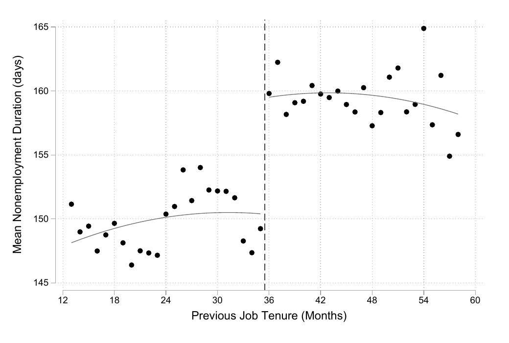

# Applied Economics Code Samples

**Alireza Shirkhodaee** · [ar.shirkhodaee@gmail.com](mailto:ar.shirkhodaee@gmail.com)

Seven self-contained projects in applied econometrics, structural estimation and computational economics, written in Python, Stata and Julia. Six were originally timed data tasks; one is independent research code. Each folder has its own README, the task description (`instruction.md`), the code, the outputs and a written report.

| # | Project | Question | Methods | Language |
|---|---------|----------|---------|----------|
| 1 | [rdd-severance-pay-replication](rdd-severance-pay-replication/) | Do severance pay and longer unemployment benefits delay re-employment? | Regression discontinuity, Cox proportional hazards | Stata |
| 2 | [auction-structural-replication](auction-structural-replication/) | Can structural auction models recover bidders' true valuations? | Nonparametric structural estimation, kernel density, risk aversion | Python |
| 3 | [dynamic-programming-clean-air](dynamic-programming-clean-air/) | How much should a government produce when output depletes clean air? | Stochastic dynamic programming, value function iteration | Julia |
| 4 | [misallocation-productivity-shocks](misallocation-productivity-shocks/) | Do common productivity shocks change capital misallocation? | Heterogeneous-firm model, investment frictions, simulation | Julia |
| 5 | [mortgage-shopping-hmda](mortgage-shopping-hmda/) | What determines mortgage prices, rejections and lender market shares? | Fixed effects, logit, BLP demand estimation | Python |
| 6 | [gravity-commuting-nyc](gravity-commuting-nyc/) | How do commuting flows respond to travel time? | Gravity regressions, binned scatterplots | Python |
| 7 | [llm-agents-cognitive-constraints](llm-agents-cognitive-constraints/) | Do LLM agents reproduce human choice patterns tied to cognitive ability? | Synthetic survey experiments with LLM agents | Python |

## Projects

### 1. Severance pay and job finding: an RD replication

Replicates and extends Card, Chetty and Weber (2007) on Austrian administrative data. Eligibility for severance pay and for extended benefits both change discontinuously with tenure, which identifies their effect on job search.

**Headline result.** Severance-pay eligibility lowers the job-finding hazard by about 12.5% and extended benefits by about 9.3% (Cox model, no controls), with no significant effect on subsequent wages or job duration.



**Run.** From the project folder: `do code/main.do` in Stata. The data are not public.

### 2. Structural estimates of auction models: a replication

Replicates Sections II to IV of Bajari and Hortaçsu (2005) on experimental first-price auction data, where true valuations are known and structural estimates can be checked against them.

**Headline result.** The risk-neutral model overstates valuations (mean absolute error 8.36 with three bidders, 2.92 with six). Allowing for risk aversion, with θ estimated at 0.15 on the 25th to 75th percentiles, cuts the error to 1.33 and 1.30.


**Run.** `pip install -r requirements.txt`, then run `code/auction_replication.ipynb`. The data are not public.

### 3. Output and clean air: a stochastic dynamic program

A government trades current output against a depleting stock of clean air, with a two-state Markov damage shock and a constant probability of leaving office. The report derives the Bellman equation, Euler equation and transversality condition; the code solves the problem by value function iteration.

**Headline result.** Optimal output rises with the stock of clean air and is higher in the low-damage state; in simulations the government cuts output whenever damage switches to the high state.


**Run.** `julia --project=. -e 'using Pkg; Pkg.instantiate()'`, then run `code/clean_air_vfi.ipynb`. No data needed.

### 4. Common productivity shocks and misallocation

Independent research code, not a data task. A dynamic partial-equilibrium model of heterogeneous firms with capital adjustment costs, partial irreversibility and size-dependent capital prices, used to ask how aggregate productivity affects the dispersion of the marginal revenue product of capital.

**Headline result.** Doubling common productivity raises output directly and also reduces misallocation by 14%, in economies where larger firms face lower capital costs.

**Run.** `julia --project=. -e 'using Pkg; Pkg.instantiate()'`, then run `code/misallocation_demo.ipynb`. No data needed.

### 5. Mortgage shopping in HMDA

Uses the 2020 HMDA loan-level file to study rate spreads by race, lender market shares within MSA × race markets, the determinants of prices and rejections, and demand for lenders. The raw file is processed in chunks because it does not fit in memory.

**Headline result.** Asian borrowers have the lowest rate spreads, followed by non-Hispanic White, Hispanic/Latino and Black borrowers. Regressions of market share on price are biased by simultaneity, which motivates a BLP discrete-choice demand model.


**Run.** `pip install -r requirements.txt`, then run the three notebooks in `code/` in order. The first one downloads the public HMDA file.

### 6. Gravity in NYC commuting flows

Describes tract-to-tract commuting in New York City and estimates gravity regressions of commuter flows on travel time by public transit and by car.

**Headline result.** 34.8% of commuters can reach work within 15 minutes by their fastest mode. A 1% longer transit time is associated with 0.41% fewer commuters in the pooled regression.


**Run.** `pip install -r requirements.txt`, then run `code/commuting_gravity.ipynb`. The data are downloaded automatically.

### 7. Cognitive constraints in LLM "silicon samples"

Builds a synthetic population of LLM agents matched to the survey groups in Frederick (2005) and asks them the same intertemporal-choice and risk questions as the human respondents.

**Headline result.** LLM agents reproduce the direction of the human patterns, including more risk-seeking over losses than over gains and the gap between cognitive-reflection groups, but with different magnitudes, and unlike humans they do not respond to question framing.


**Run.** `pip install -r requirements.txt`, set `EXPECTED_PARROT_API_KEY`, then run `code/silicon_samples_experiment.ipynb`.

## Repository layout

Every project follows the same structure:

```
project-name/
├── README.md          question, method, result, how to run
├── instruction.md     the task as posed (data tasks only)
├── code/              notebooks, do-files or Julia modules
├── data/              README explaining how to obtain the data
├── output/            figures and tables produced by the code
├── report/            written report (PDF)
└── requirements.txt   or Project.toml for Julia
```

## Reproducibility

- All paths are relative to the project folder.
- Python dependencies are listed in each `requirements.txt`; Julia dependencies in each `Project.toml`; Stata packages are installed by `main.do`.
- Some data are not publicly available and are not redistributed here. Each `data/README.md` says what is needed and where it goes.
- The data tasks were completed under time limits. Where AI tools were used, this is disclosed in the project's report.

## License

Code is released under the [MIT License](LICENSE).
