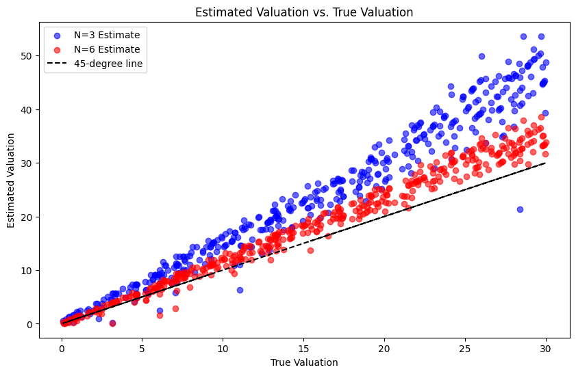

# Structural estimates of auction models: a replication

*Originally a timed data task. The task is described in [instruction.md](instruction.md).*

## Question

Do structural models of first-price auctions recover bidders' true valuations? Experimental data make this testable, because the valuations are assigned by the experimenter. This project replicates Sections II to IV of Bajari and Hortaçsu (2005).

## Method

- Compare observed bids with risk-neutral Nash equilibrium bids, and compute expected profits and optimization errors from empirical bid distributions.
- Estimate the bid density with a Gaussian kernel and Silverman's rule-of-thumb bandwidth, and the bid distribution with the empirical CDF.
- Invert the first-order condition to recover each bidder's valuation, with three and with six bidders.
- Estimate the risk-aversion parameter θ by OLS on bid percentiles, and re-estimate valuations under risk aversion.
- Score each model by the L1 and L2 distance between estimated and true valuations.

## Headline result

The risk-neutral model overstates valuations: the mean absolute error is 8.36 with three bidders and 2.92 with six. With risk aversion (θ = 0.15, estimated on the 25th to 75th percentiles) the error falls to 1.33 and 1.30.



## Layout

```
code/auction_replication.ipynb   full replication, in the order of the task
data/                            not included (see data/README.md)
output/figures/                  figures exported from the notebook
report/report.pdf                full write-up
requirements.txt
```

## How to run

```bash
pip install -r requirements.txt
jupyter notebook code/auction_replication.ipynb
```

Place `auctions.csv` in `data/` first. The notebook reads it from `../data/auctions.csv`.

## Data availability

The data set is not publicly available through this repository. See [data/README.md](data/README.md).

## Reference

Bajari, P., and A. Hortaçsu (2005). "Are Structural Estimates of Auction Models Reasonable? Evidence from Experimental Data." *Journal of Political Economy*, 113(4): 703-741.

## Contact

Alireza Shirkhodaee · ar.shirkhodaee@gmail.com
