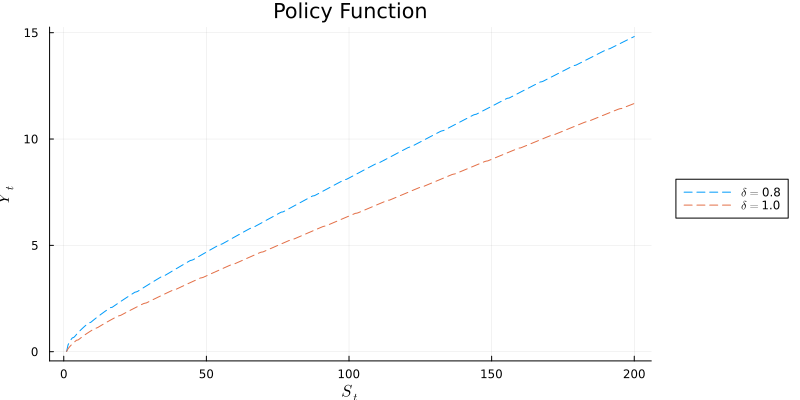

# Output and clean air: a stochastic dynamic program

*Originally a timed data task. The task is described in [instruction.md](instruction.md).*

## Question

How much should a government produce each year when production depletes a slowly regenerating stock of clean air, the damage per unit of output is random, and the government may be removed from office?

## Method

- Write the problem recursively, with the stock of clean air and the damage state as state variables and next period's stock as the choice.
- Derive the first-order and envelope conditions, the Euler equation and the transversality condition (in the report).
- Solve by value function iteration on a 400-point grid, with linear interpolation of the value function and a continuous maximization at each grid point.
- Simulate the two-state Markov chain for damage and the implied paths of output and clean air.

## Headline result

Optimal output increases with the stock of clean air and is higher in the low-damage state. In simulations the government cuts output when damage switches to the high state and raises it again when damage falls.



## Layout

```
code/clean_air_vfi.ipynb     model, solver, plots and simulation
output/figures/              figures written by the notebook
report/report.pdf            derivations and discussion
report/notebook_export.pdf   static copy of the notebook
Project.toml                 Julia dependencies
```

## How to run

```bash
julia --project=. -e 'using Pkg; Pkg.instantiate()'
julia --project=. -e 'using IJulia; notebook(dir="code")'
```

Then open `clean_air_vfi.ipynb`. Written for Julia 1.6. The simulation draws random shocks without a fixed seed, so simulated paths differ from run to run.

## Data availability

No data are needed. The exercise is purely computational.

## Contact

Alireza Shirkhodaee · ar.shirkhodaee@gmail.com
