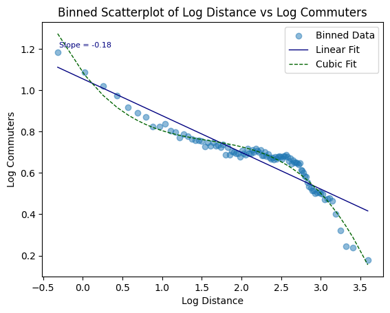

# Gravity in NYC commuting flows

*Originally a timed data task. The task is described in [instruction.md](instruction.md).*

## Question

How do commuting flows between New York City census tracts respond to distance and travel time?

## Method

- Summary statistics for 689,550 tract pairs, and the share of commuters within 15 minutes of work by their fastest mode.
- Aggregation of tract flows to a county-to-county commuting matrix.
- A binned scatterplot of log commuters against log distance, with 100 equal-sized bins.
- Three gravity regressions of log commuters on log travel time by public transit and by car, with tract fixed effects.

## Headline result

34.8% of commuters can reach work within 15 minutes by their fastest mode. A 1% longer transit time is associated with 0.41% fewer commuters in the pooled regression. When both travel times are included, the coefficient is -1.04 on transit time and +0.61 on car time.



## Layout

```
code/commuting_gravity.ipynb          full analysis
data/                                 downloaded at run time (see data/README.md)
output/nyc_commuting_counties.csv     county-to-county flows
output/tables/                        summary statistics and regression tables (LaTeX)
output/figures/                       binned scatterplot, flow map, heatmap, Sankey diagram
report/report.pdf                     full write-up
requirements.txt
```

## How to run

```bash
pip install -r requirements.txt
jupyter notebook code/commuting_gravity.ipynb
```

The notebook downloads the commuting data into `data/` and writes its results to `output/`. An internet connection is required.

## Data availability

The data are downloaded automatically from a public URL and are not stored here.

## Contact

Alireza Shirkhodaee · ar.shirkhodaee@gmail.com
