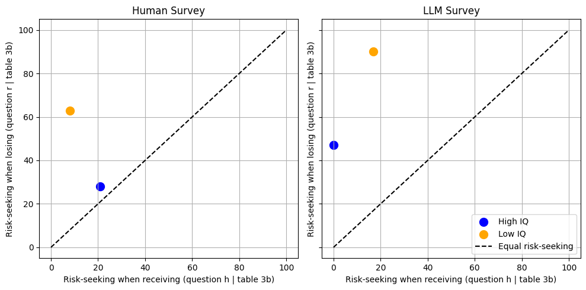

# Cognitive constraints in LLM "silicon samples"

*Originally a timed data task. The task is described in [instruction.md](instruction.md).*

## Question

How well do LLM agents instructed to simulate humans reproduce choice patterns that are attributed to cognitive constraints?

## Method

- Build a synthetic population of LLM agents whose cognitive-reflection level, location and persona follow the survey groups in Frederick (2005), at 10% of the original sample size.
- Ask the agents the same intertemporal-choice questions and the same risk questions over gains and losses as the human respondents, using the `edsl` package with remote inference.
- Compare the shares choosing each option with the human survey, separately for high and low cognitive-reflection groups.
- Test for a framing effect by adding further questions to the survey.

## Headline result

LLM agents reproduce the direction of the human patterns: both groups are more risk-seeking over losses than over gains, and the low cognitive-reflection group more so. The magnitudes differ from the human data, and unlike humans the agents do not respond to framing.



## Layout

```
code/silicon_samples_experiment.ipynb   agents, surveys, comparison with human data
output/figures/                         figure exported from the notebook
report/report.pdf                       full write-up
requirements.txt
```

## How to run

```bash
pip install -r requirements.txt
export EXPECTED_PARROT_API_KEY=your_key
jupyter notebook code/silicon_samples_experiment.ipynb
```

The key is read from the environment and is never stored in the notebook. Running the surveys uses remote-inference credits, and LLM responses are not deterministic, so numbers will differ somewhat between runs.

## Data availability

There is no external data set. The human benchmarks are taken from the tables in Frederick (2005), and the LLM responses are generated by the notebook.

## Reference

Frederick, S. (2005). "Cognitive Reflection and Decision Making." *Journal of Economic Perspectives*, 19(4): 25-42.

## Contact

Alireza Shirkhodaee · ar.shirkhodaee@gmail.com
