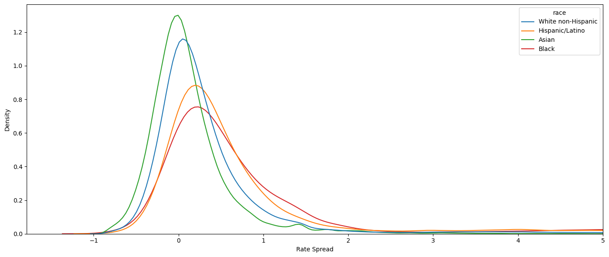

# Mortgage shopping in HMDA

*Originally a timed data task. The task is described in [instruction.md](instruction.md).*

## Question

How do mortgage prices differ across borrowers, what determines prices and rejections, and how do lenders' market shares respond to price?

## Method

- **Data.** The 2020 HMDA loan-level file, restricted to conventional first-lien purchase mortgages for owner-occupied single-family homes in the top 20 metropolitan areas. The raw file is read in chunks because it does not fit in memory.
- **Markets.** A market is an MSA × race cell. Lender shares are computed within markets, together with alternative measures of lender presence.
- **Prices and rejections.** Fixed-effects regressions for interest rates and rate spreads, and a logit model for rejection.
- **Demand.** Regressions of market shares on prices, followed by a Berry-Levinsohn-Pakes discrete-choice model to address price endogeneity.

## Headline result

Asian borrowers have the lowest rate spreads, followed by non-Hispanic White, Hispanic/Latino and Black borrowers. Regressions of market share on price are biased because shares and prices are determined jointly, which motivates the discrete-choice demand model.



## Layout

```
code/
  01_data_cleaning.ipynb        download, chunked filtering, variable construction
  02_summary_statistics.ipynb   summary tables and distributions by race
  03_regressions.ipynb          price, rejection and demand models
data/                           not included (see data/README.md)
output/figures/                 figures
output/tables/                  LaTeX tables written by the notebooks
report/report.pdf               full write-up
requirements.txt
```

## How to run

```bash
pip install -r requirements.txt
```

Run the three notebooks in `code/` in order. The first writes `data/processed/filtered_data.csv` and `cleaned_data.csv`, which the other two read.

## Data availability

The raw data are public but several gigabytes in size, so they are not stored here. See [data/README.md](data/README.md).

## Contact

Alireza Shirkhodaee · ar.shirkhodaee@gmail.com
